# zmk-config-glove65tb<!-- omit in toc -->

- Glove65tb用のZMKファームウェア

## Glove65tbとは<!-- omit in toc -->

- Xiao nRF52840 Plus（Xiao BLE Plus）を採用した技適対応のワイヤレスキーボード
- 低背トラボケース（25mmトラボ対応）により、従来比でトラボケース高さ`-7mm`, トラックボール高さ`-3.5mm`を実現し、手のひらとの干渉を防止
- Bluetooth接続（最大5台）とType-Cケーブルによる有線接続が可能
- `Cherry MXスイッチ`と`ロープロファイルスイッチ`（Choc V1, Choc V2_ガイドピン無し）に対応
- 500mAhバッテリーを採用しながら薄型デザインを実現
- 左側キーボードにロータリーエンコーダを搭載

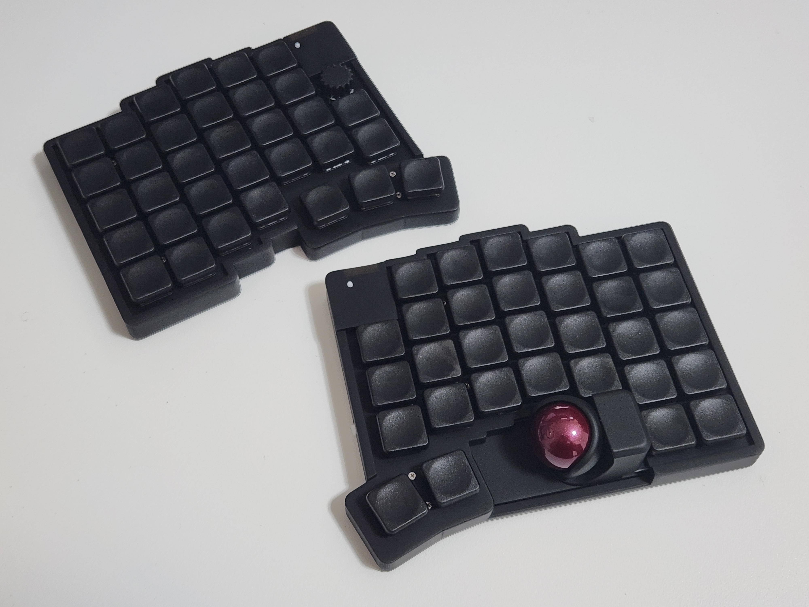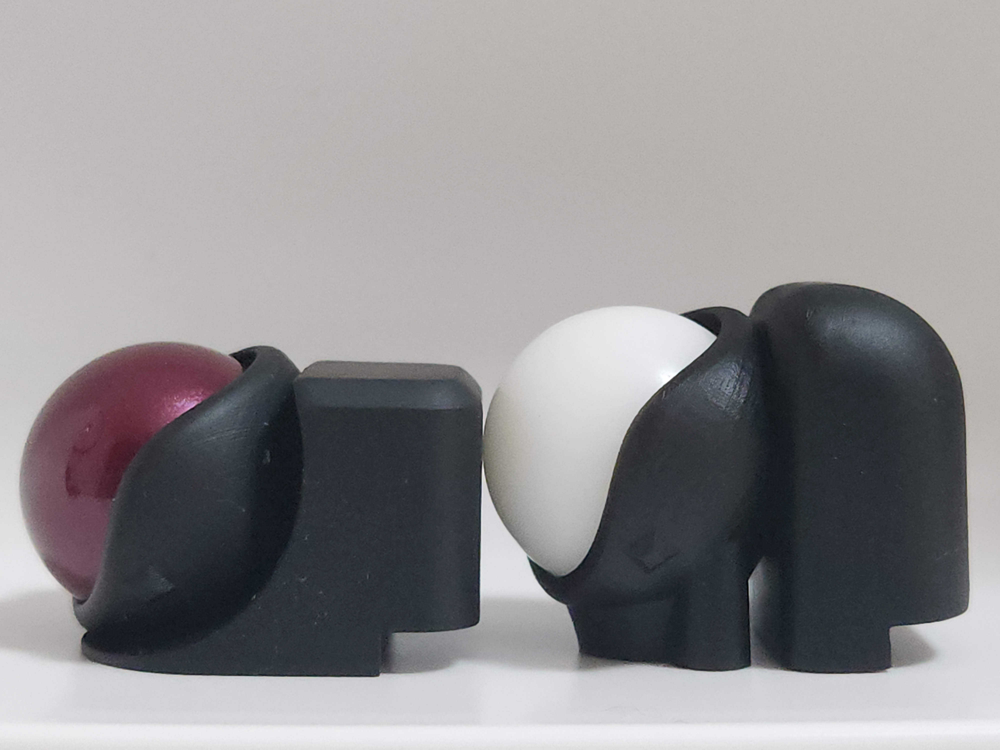

## スペック表<!-- omit in toc -->

| 項目 | 詳細 |
| -- | -- |
| ファームウェア | ZMK Firmware |
| 接続方式 | 有線接続（Type-C）<br>Bluetooth（最大5台） |
| 対応キースイッチ | ✅Choc V1<br>✅Choc V2（ガイドピン無し）<br>❌Choc V2（ガイドピン有り）<br>✅Lofree Ghost（Choc V2互換）<br>✅CherryMX |
| バッテリー容量 | 500mAh |
| バッテリー駆動時間 | おおよそ1ヶ月ほど |
| ロータリーエンコーダ | ロープロファイル規格のエンコーダーを左側キーボードに配置 |

## キーボードレイアウト<!-- omit in toc -->


Google Driveにもキーマップ画像を保存する場合は、[自動アップロードの設定手順](docs/keymap-google-drive.md)を参照してください。

# Docs<!-- omit in toc -->

- [ZMKファームウェアをビルドしてキーマップを変更する](#zmkファームウェアをビルドしてキーマップを変更する)
  - [全体の流れ](#全体の流れ)
  - [1. GitHubアカウントを作成する](#1-githubアカウントを作成する)
  - [2. ZMKファームウェアのリポジトリをフォークする](#2-zmkファームウェアのリポジトリをフォークする)
  - [3. GitHub Actionsの有効化](#3-github-actionsの有効化)
  - [4. KeymapEditorとフォークしたリポジトリを連携する](#4-keymapeditorとフォークしたリポジトリを連携する)
  - [5. KeymapEditorでキー配列変更してファームウェアをビルドする](#5-keymapeditorでキー配列変更してファームウェアをビルドする)
  - [6. ファームウェアをキーボードに書き込む](#6-ファームウェアをキーボードに書き込む)
    - [6-1. 右側キーボードにファームウェアを書き込む](#6-1-右側キーボードにファームウェアを書き込む)
    - [6-2. 左側キーボードにファームウェアを書き込む](#6-2-左側キーボードにファームウェアを書き込む)
  - [7. 完了](#7-完了)
- [ZMK Studioでキーマップを変更する](#zmk-studioでキーマップを変更する)
  - [1. `右側キーボード`とPCをType-Cケーブルで接続する](#1-右側キーボードとpcをtype-cケーブルで接続する)
  - [2. `ZMK Studio`にアクセス](#2-zmk-studioにアクセス)
  - [3. キーマップを変更するキーボードを選択](#3-キーマップを変更するキーボードを選択)
  - [4. キーマップを変更する](#4-キーマップを変更する)
  - [5. 完了](#5-完了)
- [現在のレイヤーをLEDの色で判別できるようにする](#現在のレイヤーをledの色で判別できるようにする)
- [バッテリー残量をLEDで確認する](#バッテリー残量をledで確認する)
- [接続状況を確認する](#接続状況を確認する)
- [オートマウスレイヤー（AML）について](#オートマウスレイヤーamlについて)
- [トラックボール操作による画面スクロールについて](#トラックボール操作による画面スクロールについて)
- [ロータリーエンコーダを取り外してキースイッチを取り付け可能](#ロータリーエンコーダを取り外してキースイッチを取り付け可能)
- [`ZMKファームウェアをビルドしてキーマップを変更する`と`ZMK Studioでキーマップを変更する`を併用することは非推奨](#zmkファームウェアをビルドしてキーマップを変更するとzmk-studioでキーマップを変更するを併用することは非推奨)
- [左側キーボードでキー入力ができなくなったときの対処方法](#左側キーボードでキー入力ができなくなったときの対処方法)

## ZMKファームウェアをビルドしてキーマップを変更する

### 全体の流れ

1. GitHubアカウントを作成する
2. ZMKファームウェアのリポジトリをフォークする
3. GitHub Actionsの有効化
4. KeymapEditorとフォークしたリポジトリを連携する
5. KeymapEditorでキー配列変更してファームウェアをビルドする
6. ファームウェアをキーボードに書き込む

### 1. GitHubアカウントを作成する

- 以下のドキュメントを参考にアカウント作成すること

  > 公式ドキュメント:
  > https://docs.github.com/ja/get-started/start-your-journey/creating-an-account-on-github
  >
  > 参考ブログ:
  > https://zenn.dev/keison8864/articles/069d9be35b92c2
  >

### 2. ZMKファームウェアのリポジトリをフォークする

- 以下のリポジトリをフォークする
  - https://github.com/keebkuro/zmk-config-glove65tb
- フォーク手順は以下の記事を参考に実施すること

  > 公式ドキュメント:
  > https://docs.github.com/ja/pull-requests/collaborating-with-pull-requests/working-with-forks/fork-a-repo
  >
  > 参考ブログ:
  > https://www.kagoya.jp/howto/rentalserver/webtrend/githubfork/
  >

### 3. GitHub Actionsの有効化

- フォークしたリポジトリの「Actions」タブに移動し、「I understand my workflows, go ahead and enable them」をクリックし、github Actionsを有効化

  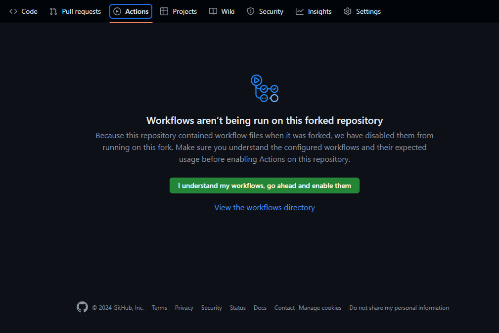

### 4. KeymapEditorとフォークしたリポジトリを連携する

- [KeymapEditor](https://nickcoutsos.github.io/keymap-editor/)にアクセス
- `GitHub` を選択

  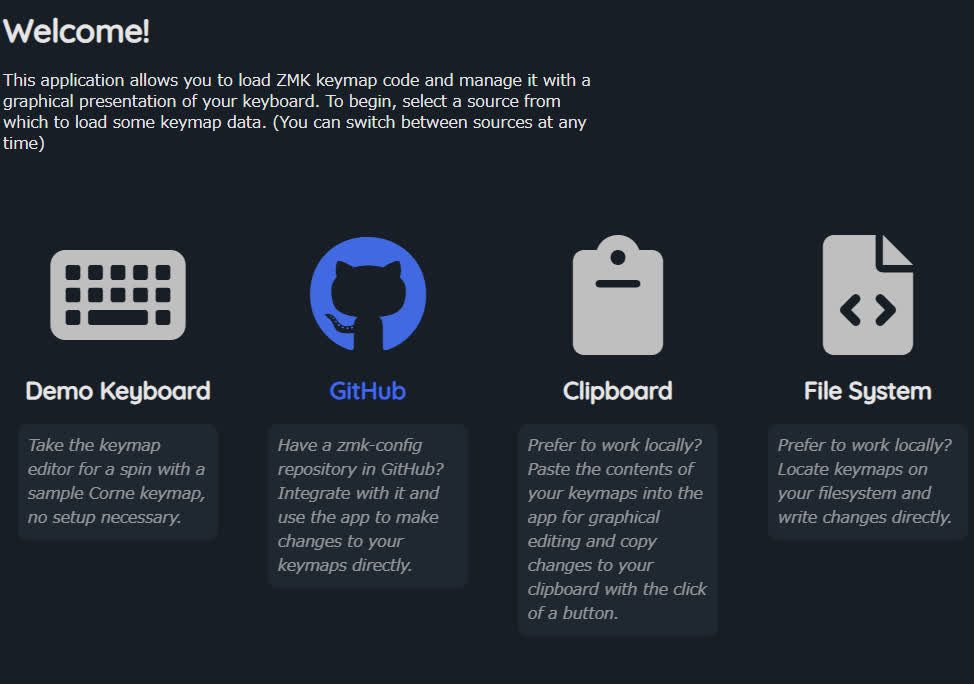

- 「Login with GitHub」からでログインし、「Authorize Keymap Editor」を選択
- 指示に従い、フォークしたリポジトリにKeymapEditorがアクセスできるように進める

### 5. KeymapEditorでキー配列変更してファームウェアをビルドする

- [KeymapEditor](https://nickcoutsos.github.io/keymap-editor/)上でキーマップが表示されたら、好きにキーマップを編集する
- 画面左上の「Save」を押すと、編集したキーマップが適用されてGitHub Actionsが走り、自動的にビルドが開始します

  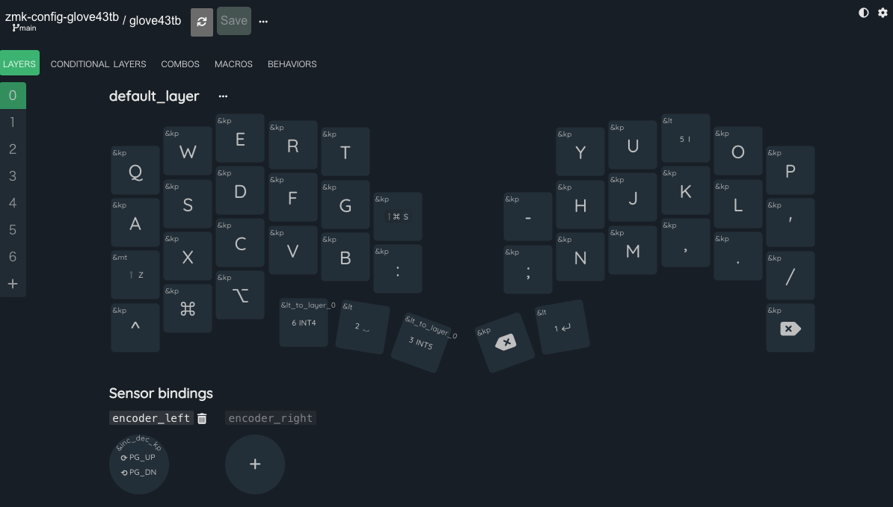

- 「Save」の隣に表示される「Latest」をクリックするとGitHubに移動し、ビルドが完了するとファームウェアがダウンロードできるようになります。（ビルドには2～4分かかる場合があります。）

### 6. ファームウェアをキーボードに書き込む

- ダウンロードしたzipファイルを解凍する

  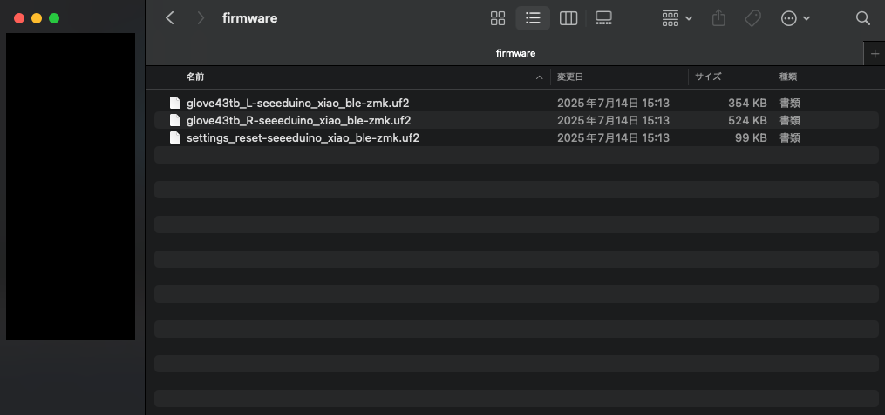

#### 6-1. 右側キーボードにファームウェアを書き込む

- `Reset Button`をダブルクリックしてブートモードに切り替える

  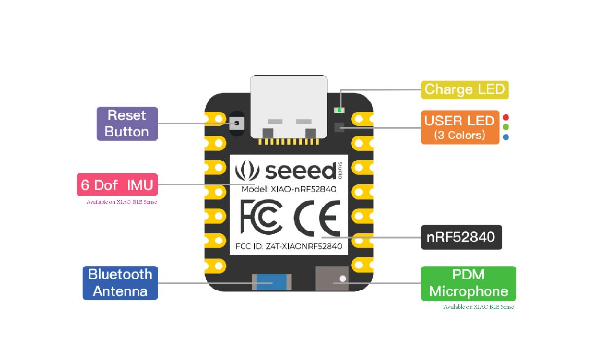

- ブートモードのときにPCとキーボードをUSB接続すると`XIAO-SENSE`というリムーバルディスクが見えるようになります

  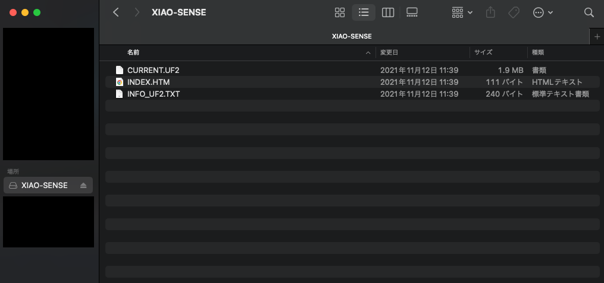

- `XIAO-SENSE`に`glove65tb_R.uf2`ファイルをドラッグアンドドロップしてください

  > 補足:
  > うまく動作しないときは、`settings_reset.uf2`を先に書き込んでリセットしてから、上述のファームウェア書き込みを実施すると解消できます
  >

#### 6-2. 左側キーボードにファームウェアを書き込む

- 右側キーボードと同じ手順で実施可能です
- 書き込むファームウェアは左側キーボード用のものに読み替えてください（`glove65tb_L.uf2`）

### 7. 完了

- キーボードのスイッチを入れ直して完了
- キー入力が正常に行えることを確認してください

## ZMK Studioでキーマップを変更する

### 1. `右側キーボード`とPCをType-Cケーブルで接続する

- 本キーボードは`右側キーボード`が親機になってますので、親機とPCをType-Cケーブルで有線接続すること

### 2. `ZMK Studio`にアクセス

- Chromeなどの任意のブラウザで[ZMK Studio](https://zmk.studio/)にアクセス
  - https://zmk.studio/

### 3. キーマップを変更するキーボードを選択

- `USB`を選択
  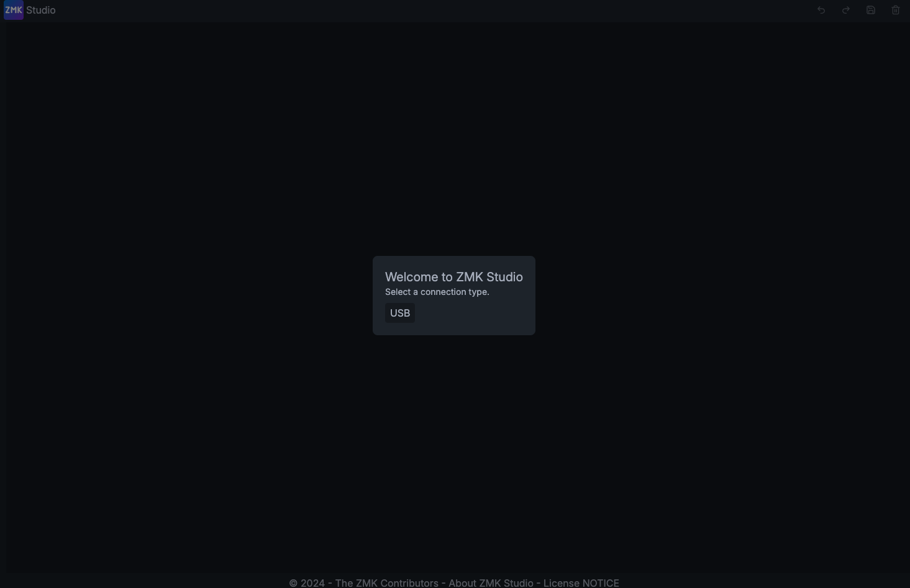
- キーボードを選択するモーダルが表示されるので、`glove65tb (cu.usbmodem11301)`を選択してから`接続`をクリック
  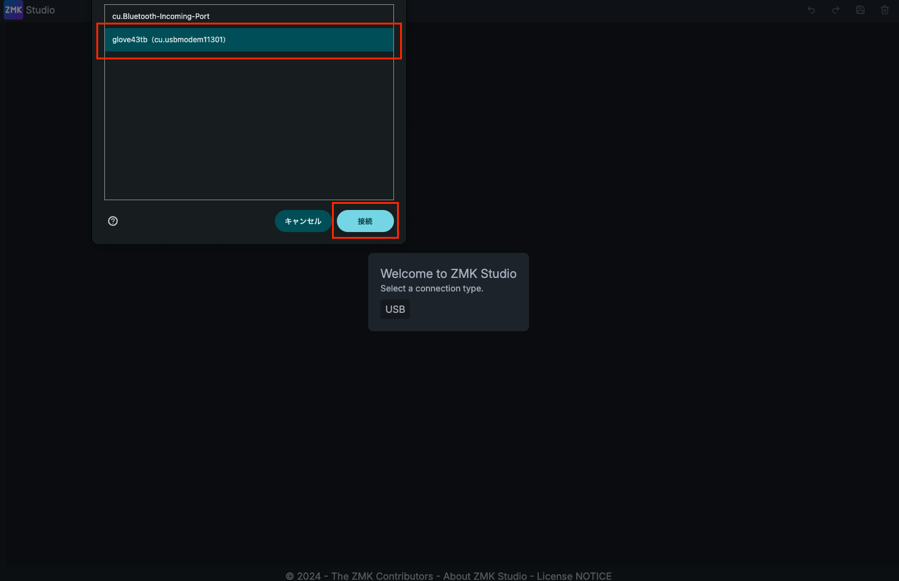

### 4. キーマップを変更する

- 変更後に右上の保存アイコンをクリックすると、変更内容をキーボードに書き込めます
  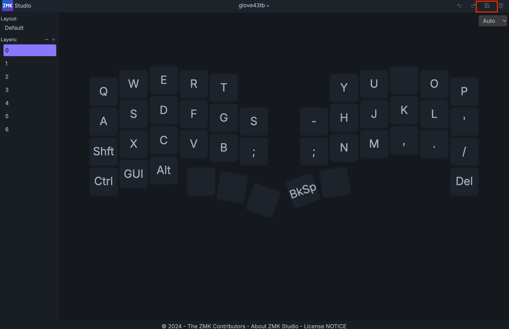

### 5. 完了

- キーボードのスイッチを入れ直して完了
- キー入力が正常に行えることを確認してください

## 現在のレイヤーをLEDの色で判別できるようにする

- 利用中のレイヤーに応じてLEDの表示色を出し分けて判別しやすくする機能がある
- 本機能を`ON/OFF`したいときは以下のファイルを修正すること
  - [boards/shields/glove65tb/glove65tb_R.conf](boards/shields/glove65tb/glove65tb_R.conf)
  - `ON`にしたいとき:
    - `CONFIG_RGBLED_WIDGET_SHOW_LAYER_COLORS=y`
  - `OFF`にしたいとき:
    - `CONFIG_RGBLED_WIDGET_SHOW_LAYER_COLORS=n`
- 色を変更したい場合は`CONFIG_RGBLED_WIDGET_LAYER_*_COLOR`の値を変更する
  - [boards/shields/glove65tb/glove65tb_R.conf](boards/shields/glove65tb/glove65tb_R.conf)
  - 色と値の組み合わせ:

    | Color | Value |
    | -- | -- |
    | none（LED非表示） | 0 |
    | Red | 1 |
    | Green | 2 |
    | Yellow | 3 |
    | Blue | 4 |
    | Magenta | 5 |
    | Cyan | 6 |
    | White |  7 |

## バッテリー残量をLEDで確認する

- `&ind_bat`を割り当てたキーを入力することで確認可能

  > `SYMレイヤー（Layer: 3）`の左側キーボードに割当済み

- LED表示色とバッテリー残量

  | LED Color | バッテリー残量 |
  | -- | -- |
  | Green | 60% |
  | Yellow | 20% |
  | Red | 10% |

- バッテリー残量の表示設定を変更したいときは以下のファイルを修正すること
  - [boards/shields/glove65tb/glove65tb_R.conf](boards/shields/glove65tb/glove65tb_R.conf)
  - `Green`として表示するバッテリー残量を変更したいとき:
    - `CONFIG_RGBLED_WIDGET_BATTERY_LEVEL_HIGH`の値を書き換える
  - `Yellow`として表示するバッテリー残量を変更したいとき:
    - `CONFIG_RGBLED_WIDGET_BATTERY_LEVEL_LOW`の値を書き換える
  - `Red`として表示するバッテリー残量を変更したいとき:
    - `CONFIG_RGBLED_WIDGET_BATTERY_LEVEL_CRITICAL`の値を書き換える

## 接続状況を確認する

- `&ind_con`を割り当てたキーを入力することで確認可能
- LED表示色とBluetooth接続状況

  | LED Color | Bluetooth接続状況 |
  | -- | -- |
  | Blue | Bluetooth接続中 |
  | Red | Bluetooth未接続 |

## オートマウスレイヤー（AML）について

- トラックボール操作時に自動的に`MOUSE Layer（Layer 4）`に切り替わる仕組みになっている
- 本機能を無効化したい場合は以下のファイルを修正すること
  - [boards/shields/glove65tb/glove65tb_R.overlay](boards/shields/glove65tb/glove65tb_R.overlay)
  - `automouse-layer = <4>;`をコメントアウトするか、コード自体を削除することで無効化できる

    ```diff
    - automouse-layer = <4>;
    + // automouse-layer = <4>;
    ```

## トラックボール操作による画面スクロールについて

- `SCROLL Layer（Layer 5）`に切り替えた状態でトラックボール操作することで、上下左右方向にスクロールすることが可能

## ロータリーエンコーダを取り外してキースイッチを取り付け可能

- ロータリーエンコーダをハンダ付けしている箇所には、キーソケット（CherryMX, Choc V1/V2）もハンダ付け済みです
- はんだごてなどでロータリーエンコーダを取り外せばキースイッチを装着可能です

## `ZMKファームウェアをビルドしてキーマップを変更する`と`ZMK Studioでキーマップを変更する`を併用することは非推奨

- ZMKファームウェアをビルドしてキーマップ変更したのに、ZMK Studioでのキーマップが優先されるケースがあるため
- キーマップがうまく書き換えできなくなった場合は、[6. ファームウェアをキーボードに書き込む](#6-ファームウェアをキーボードに書き込む)で`settings_reset.uf2`を書き込む手順を含めて実行すると解消可能です

## 左側キーボードでキー入力ができなくなったときの対処方法

- 左右キーボード間のペアリングが失敗している状態です
- [6. ファームウェアをキーボードに書き込む](#6-ファームウェアをキーボードに書き込む)で`settings_reset.uf2`を書き込む手順を含めて実行すると解消可能です
- `右側キーボード -> 左側キーボード`の順番で実行すると良いです
